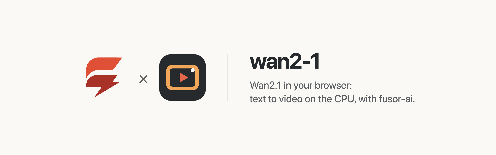
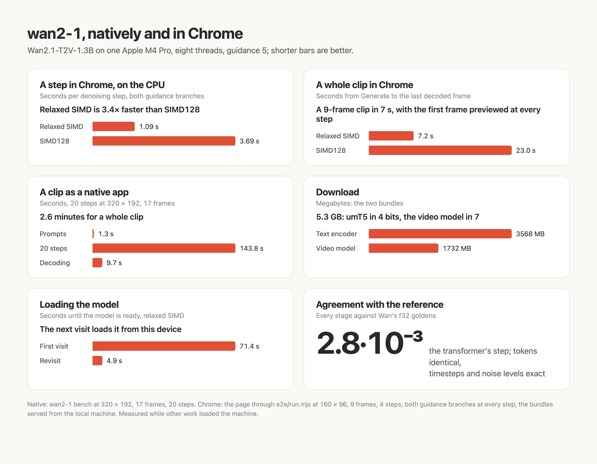

<p>
  <picture>
    <source media="(prefers-color-scheme: dark)" srcset="assets/brand/banner-dark.png">
    
  </picture>
</p>

# Text to video in the browser, on the CPU

Describe a clip and watch it take shape, made by [Wan2.1-T2V-1.3B](https://huggingface.co/Wan-AI/Wan2.1-T2V-1.3B), Wan-AI's open text-to-video diffusion model, computed on your own device. No server, no API key, no GPU required, and once the model has loaded, nothing you type leaves the page.

wan2-1 is the app around the model: a [fusor](https://github.com/fusor-rs/fusor) page, the browser runtimes and a native CLI. The model itself, compiled to WebAssembly, is built with [fusor-ai](https://github.com/fusor-rs/fusor-ai), the toolkit for AI runtimes in Rust and WebAssembly, from the published weights.

**In development · v0.1**: this is experimental software. See [status and known limitations](#status-and-known-limitations).

[Run it](#run-it-locally) · [How it works](#how-it-works) · [How fast is it](#how-fast-is-it) · [Status](#status-and-known-limitations)

## Run it locally

You need Rust 1.99 or newer, installed with [rustup](https://rustup.rs), Node.js 22 or newer and [`just`](https://github.com/casey/just). Then:

```sh
git clone --recurse-submodules https://github.com/fusor-rs/wan2-1-wasm && cd wan2-1-wasm
just ui
```

and open the address it prints. `just ui` installs the pinned tools, downloads the checkpoint at a pinned revision (17.5 GB, each file sha256-checked), compiles it into two bundles (3.57 GB for the text encoder, 1.73 GB for the video model), builds the browser runtimes and the page, and serves it on `http://localhost:8787` with the bundles beside it.

Write a prompt and press **Generate**, even while the model is still loading: the request waits and starts the moment the model is ready. After every step the page draws the first frame as that step predicts it; when the steps are done the decoder paints the frames one latent frame at a time, and the clip plays in a loop, ready to download as a WebM. The negative prompt starts as Wan's own; size, frames, steps, guidance, shift and the seed are yours to change, and the same seed and settings give the same clip. Every generation is measured live: the time, the seconds per step, the steps done, and the network requests since the model loaded, which stay at zero.

## More ways to run it

### Build everything from source

```sh
just build    # also downloads the checkpoint and compiles the bundles
just serve
```

`CHECKPOINT=<dir>` reuses a checkpoint you already have, and `PROFILE=f32` compiles the 12.4 GB full-precision bundles that `just parity` checks against the reference.

### The CLI

The CLI generates a clip without a browser, as a folder of PNG frames:

```sh
target/release/wan2-1 generate dist/model --prompt "a red fox in the snow" --frames 9 --out fox
target/release/wan2-1 generate dist/model --prompt "a lighthouse at dusk" --width 192 --height 320 --steps 25 --seed 7
```

`wan2-1 bench` times each stage and `wan2-1 parity` compares every stage with the reference's outputs.

## How it works

- **Two runtimes, two memories.** A WebAssembly memory holds at most 4 GiB, and the model's text encoder (umT5-XXL, 5.7 billion parameters) and its video model together do not fit in one. The page runs them as two instances in two workers; the encoder's output, the prompt's and the negative prompt's states, crosses to the video instance as bytes through the page.
- **The text encoder in 4 bits, the video model in 7.** The bundles store umT5's large matrices in 4 bits and the transformer's and the decoder's in 7, with a scale per 32 values (fusor-ai's `Q4b32` and `Q7b32`); the matrix multiply quantizes activations to int8 on the fly and adds up each group's products as integers.
- **The sampler.** From seeded noise, DPM-Solver++(2M) at Wan's shifted flow-matching noise levels asks the transformer for the noise of the prompt and of the negative prompt at every step and steers between them (classifier-free guidance).
- **Watch it form.** After every step the page decodes the first frame the step predicts. At the end the decoder turns the latents into frames one latent frame at a time, with causal 3-D convolutions that carry their history from one latent frame to the next.
- **Checked against the reference.** Every stage agrees with Wan's own modules in full precision: the tokens and the schedule exactly, umT5's states within 3.4·10⁻² (relative), the transformer's step within 2.8·10⁻³, the decoder within 1.2·10⁻⁴.
- **Threads and SIMD where the browser has them.** The page picks one of four builds: worker threads when it is cross-origin isolated, relaxed SIMD when the engine supports it, plain SIMD128 everywhere else. The page's frames equal, byte for byte, those of the same build run single-threaded in Node.
- **Downloaded once, verified always.** The bundles stream in parts, each checked against its BLAKE3 hash, and stay in the browser's origin-private storage, so the next visit loads from this device in a few seconds.
- **Sealed.** The runtimes import no network, storage, clock or entropy capability; fusor-ai's import check proves it on every build. The page counts its network requests while it generates, and the count is zero.
- **A fusor page.** The form, the loading and the measurements are Rust signals with HTML templates; a small JavaScript module runs the engine workers and draws on the canvas.

## How fast is it

Measured on an Apple M4 Pro, eight threads, with other work loading the machine (the figures are from `just integrate`, in [benchmarks](assets/benchmarks/benchmarks.png)):

- **Natively**, the CLI generates 17 frames of 320 × 192 in 20 steps in 154.7 s: 1.3 s for both prompts, 7.2 s a step (both guidance branches) and 9.7 s to decode the frames.
- **In Chrome**, a small clip (160 × 96, 9 frames, 4 steps) takes 7.2 s, 1.09 s a step, with relaxed SIMD, and 23.0 s, 3.69 s a step, with plain SIMD128. The first visit downloaded the 5.3 GB of bundles from the local server in 71 s with the relaxed build (the SIMD128 run measured 180 s, with the machine busier); the next visit loads them from the browser's storage in 4.8 s. From the deployed Space, the first visit took 31 minutes to download them on this machine's connection, where Chrome's parallel downloads from the model repo ran at 2 to 4 MB/s and a single stream at about 26 MB/s.
- **At the page's default** (320 × 192, 17 frames, 20 steps) the page has not been timed. An estimate from the small clip's rate and the extra work (about 6.7 times its floating-point operations a step) is 7 to 12 s a step, 2.5 to 4.5 minutes for the clip.

<picture>
  <source media="(prefers-color-scheme: dark)" srcset="assets/benchmarks/benchmarks-dark.png">
  
</picture>

Both guidance branches run at every step, as in the reference; a guidance of 1 runs only the prompt's and takes half the time.

## Status and known limitations

wan2-1 is v0.1 and experimental.

### Platform status

| Platform or capability | Status |
| --- | --- |
| Chrome and Edge, threads and relaxed SIMD | Headless Chrome end-to-end check (`just e2e`): generate while loading, preview, the frames equal to the same build in Node, the WebM, revisit |
| Browsers without relaxed SIMD (Safari, older Firefox) | SIMD128 builds, checked in Chrome with threads and in Node single-threaded (`just smoke`); not tested in those browsers |
| Native CLI (macOS on Apple silicon) | Built and measured; no release archives yet |
| Phones and small machines | Not supported: the two instances need about 7 GB of memory in one tab (an estimate from the memory arithmetic, not a measurement) |

**Not supported yet:**

- Sizes above 65 536 pixels (256 × 256) or sides over 512, and more than 33 frames.
- The first download is 5.3 GB.
- Text to video only: no image to video, no video editing, no other Wan2.1 checkpoint.
- Prompts are cut at 511 tokens, and the prompt frontend repeats the reference's ligature, quote and width fixes but not the rest of `ftfy` or its HTML unescaping.
- The `unipc` solver of the reference; DPM-Solver++(2M) runs instead.
- A GPU backend.

The model is [Wan2.1-T2V-1.3B](https://huggingface.co/Wan-AI/Wan2.1-T2V-1.3B) by Wan-AI, under the Apache-2.0 license; its license ships with the bundles as `model/LICENSE`.

## How is this different from Wan's own code?

[Wan2.1](https://github.com/Wan-Video/Wan2.1) is the reference: Python on PyTorch, on GPUs. wan2-1 is a separate implementation on fusor-ai: the same weights and the same sampler's maths, its own kernels, checked stage by stage against Wan's modules, running in the browser on the CPU. It is far slower than a GPU; it needs no GPU and no server.

## Contributing

wan2-1 is an open source project in early development. The page lives in `app/`; the runtimes and the CLI live in fusor-ai's `models/wan2-1`; the model and its toolkit come from fusor-ai, its crates and browser scripts from the `vendor/fusor-ai` submodule. [AGENTS.md](AGENTS.md) is the code standard every change follows, and `just check` its check.

wan2-1 is built with the help of AI tools, mainly Claude Code, under the same rules the project asks of contributors.

## License

Licensed under the [MIT License](LICENSE).
